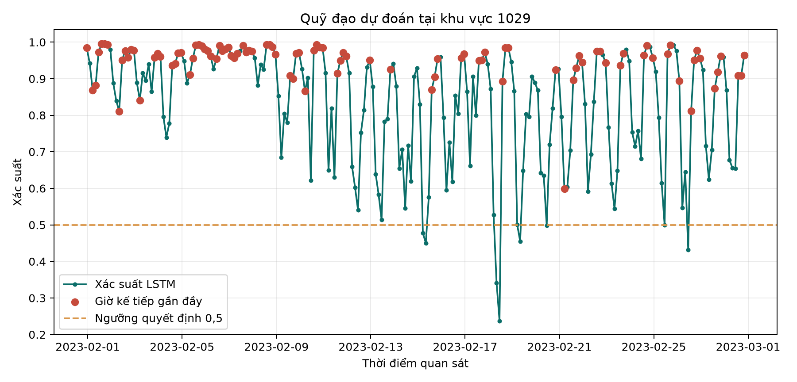
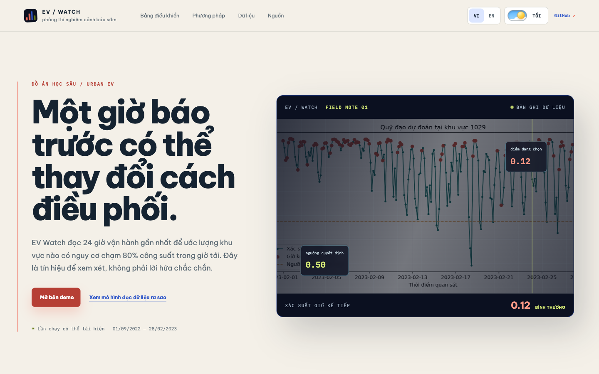
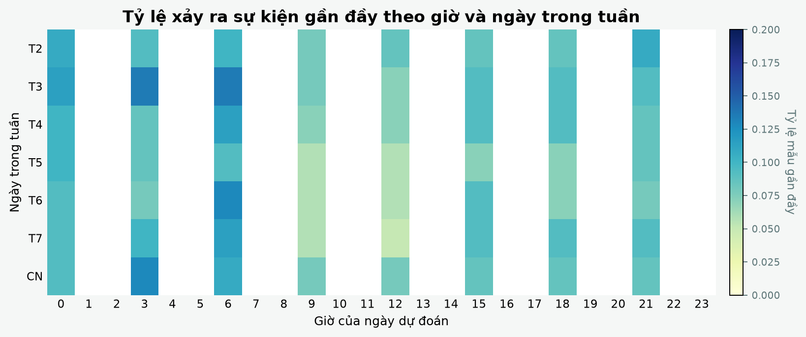
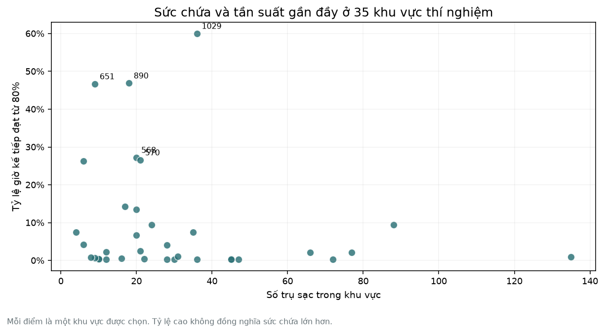
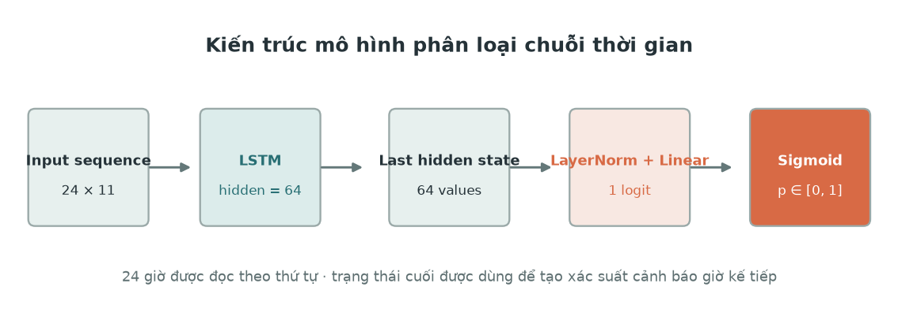
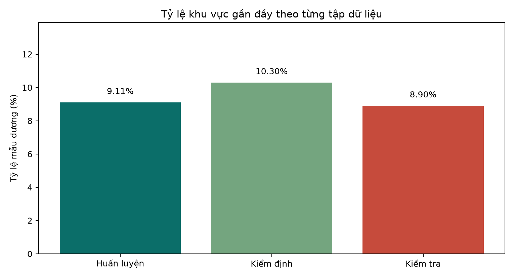
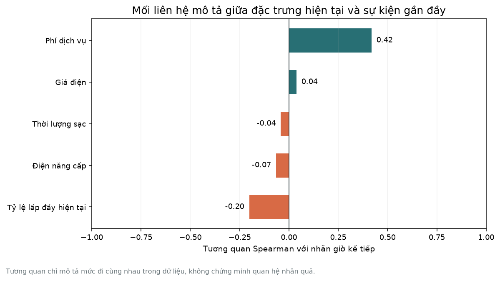
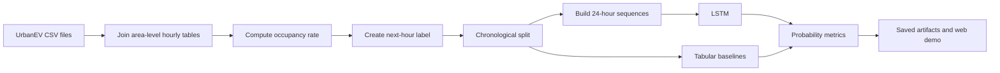
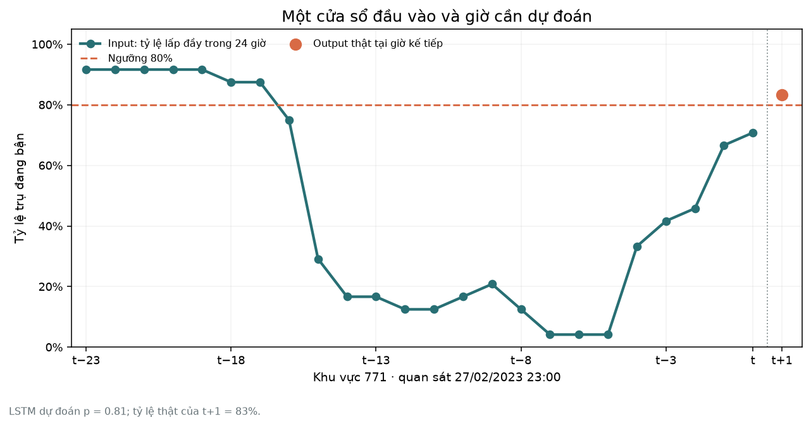

# EV Watch

> Early warning for electric vehicle charging areas that may become highly occupied in the next hour, using an LSTM model.

[](https://thang-uit.github.io/ev-charging-area-early-warning/)
[](https://github.com/thang-uit/ev-charging-area-early-warning)
[](https://doi.org/10.5061/dryad.np5hqc04z)

This is an individual learning project for the IS6109 Deep Learning and Business Applications course. It uses the public UrbanEV dataset to study whether a charging area is likely to reach at least 80% occupancy during the following hour.

The project includes a reproducible notebook, saved evaluation artifacts, and a bilingual static web demo. The web demo explains the prediction in an operational context. It does not retrain the model in the browser.

## Table of Contents

- [Overview](#overview)
- [Live Demo](#live-demo)
- [Visual Evidence](#visual-evidence)
- [Task Definition](#task-definition)
- [Dataset](#dataset)
- [Method](#method)
- [Results](#results)
- [Repository Structure](#repository-structure)
- [Quick Start](#quick-start)
- [Web Demo](#web-demo)
- [Limitations](#limitations)
- [Acknowledgment](#acknowledgment)
- [References](#references)
- [Tiếng Việt](#tiếng-việt)
  - [Tổng quan](#tổng-quan)
  - [Bài toán](#bài-toán)
  - [Dữ liệu](#dữ-liệu)
  - [Phương pháp](#phương-pháp)
  - [Kết quả](#kết-quả)
  - [Cấu trúc thư mục](#cấu-trúc-thư-mục)
  - [Cách chạy](#cách-chạy)
  - [Giới hạn](#giới-hạn)
  - [Ghi nhận nguồn](#ghi-nhận-nguồn)

## Overview

### Why this problem matters

When a charging area becomes crowded, drivers may need to wait and operators may need to redistribute capacity or adjust the service plan. A one-hour warning is useful because it leaves time for a human operator to inspect the live situation and decide what to do.

### What this project predicts

At the end of hour `t`, the model reads the previous 24 hours for one charging area and returns a probability:

```text
24 hourly observations -> model -> probability of high occupancy at t + 1
```

The business label is:

```text
high_occupancy(t + 1) = 1 when occupancy_rate(t + 1) >= 0.80
```

The LSTM is the main deep learning model. Logistic Regression and Histogram Gradient Boosting are included as baselines so the project can compare sequence learning with conventional tabular approaches.

## Live Demo

Open the deployed demo:

**Live website:** [Open EV Watch on GitHub Pages](https://thang-uit.github.io/ev-charging-area-early-warning/)

The web now uses an urban data-atlas direction: warm paper in light mode, graphite navy in dark mode, coral warning signals, ice-blue data marks and a thin reading rail connecting the selected area to its evidence. The demo remains static and fast to inspect. It does not retrain the model in the browser.

The interface supports:

- Vietnamese and English
- Light and dark themes
- Charging-area and observation-time selection
- Current occupancy, next-hour occupancy and LSTM probability
- Probability trend and model comparison
- Coordinate-based spatial map of the 275 source areas, with the 35 experiment areas highlighted
- Styled keyboard-friendly area and observation-time selectors
- Notebook figures embedded as evidence, not decorative stock images
- Links to the original dataset and source repository
- Lucian UX/UI Prompt components adapted for the theme switch and custom listbox

[](https://thang-uit.github.io/ev-charging-area-early-warning/)



## Visual Evidence

The demo uses figures generated by the notebook so the interface and the report point to the same experiment.

### UI component attribution

The compact day/night switch and animated custom listbox are adapted from [Lucian UX/UI Prompt #021](https://lucianlabs.dev/uxui-prompt/#021) and [#031](https://lucianlabs.dev/uxui-prompt/#031). The original elements are MIT-licensed by [Seokwoooo](https://github.com/Seokwoooo). Their structure and motion were adapted to the existing EV Watch theme, data flow and bilingual interface.







## Task Definition

| Item | Definition |
| --- | --- |
| Business problem | Warn when an EV charging area may become highly occupied in the next hour |
| Input | The previous 24 hours for one area, with 11 numeric and time-derived features per hour |
| Output | A probability between 0 and 1 |
| Positive label | `occupancy_rate(t + 1) >= 0.80` |
| Task type | Binary classification with probability estimation |
| Main model | Long Short-Term Memory network, or LSTM |
| Baselines | Logistic Regression and Histogram Gradient Boosting |
| Intended user | A human operator who needs an early prioritization signal |

The probability is not a guaranteed future value. It is a model signal that must be read together with current conditions and verified against the live operating system before an operational decision is made.

## Dataset

### Source and scope

The project uses the hourly area-level files from the public UrbanEV dataset.

- Dataset page: [Dryad UrbanEV dataset](https://doi.org/10.5061/dryad.np5hqc04z)
- Official repository: [IntelligentSystemsLab/UrbanEV](https://github.com/IntelligentSystemsLab/UrbanEV)
- Dataset paper: [Scientific Data, 2025](https://doi.org/10.1038/s41597-025-04874-4)
- License information: [CC0 1.0 Universal](https://creativecommons.org/publicdomain/zero/1.0/)

The hourly source covers 275 charging areas and 4,344 hourly timestamps from September 1, 2022 to February 28, 2023. The full area-hour view contains approximately 1.19 million rows. The experiment stored in this repository uses 35 selected areas and produces 7,840 chronologically ordered test samples.

### Files used by the notebook

| File | Meaning |
| --- | --- |
| `charge_1hour/occupancy.csv` | Number of occupied charging piles for each area and hour |
| `charge_1hour/duration.csv` | Total charging duration during each hour, in hours |
| `charge_1hour/volume.csv` | Energy delivered during each hour, in kWh |
| `charge_1hour/e_price.csv` | Electricity price for an area and time |
| `charge_1hour/s_price.csv` | Service price for an area and time |
| `charge_1hour/volume-11kw.csv` | A volume variant based on the standard 11 kW charging power, not used in the main model |
| `zone-information.csv` | Static area information such as capacity, coordinates, area and perimeter |
| `adj.csv` | Area adjacency information, reserved for a future spatial extension |
| `distance.csv` | Pairwise area distance information, reserved for a future spatial extension |

### Features passed to the model

The notebook builds the following 11 features for each area and hour:

| Feature | Meaning |
| --- | --- |
| `occupancy_rate` | Occupied piles divided by the area's charging capacity |
| `volume_kwh` | Energy delivered during the hour |
| `duration_hours` | Total charging duration during the hour |
| `electricity_price` | Electricity price at that time |
| `service_price` | Service price at that time |
| `hour_sin`, `hour_cos` | Cyclic representation of the hour of day |
| `weekday_sin`, `weekday_cos` | Cyclic representation of the day of week |
| `is_weekend` | Whether the timestamp falls on Saturday or Sunday |
| `capacity_log` | Log-transformed charging capacity to reduce scale differences |

The target is created from the following hour. Features are normalized using training data only. Chronological splitting keeps future observations out of training and reduces the risk of temporal leakage.

### Dataset figures







## Method

### End-to-end pipeline



### Sequence design

For one training example, the input has shape `24 x 11`:

- `24` is the number of historical hours
- `11` is the number of features at each hour
- the output is one probability for the following hour



### Why LSTM is used

An LSTM is a recurrent neural network designed for ordered data. It processes the sequence one time step at a time and uses gates to control which information is kept, updated or forgotten. This makes it suitable for testing whether the order of charging activity across the previous 24 hours contains useful information for the next-hour warning.

The LSTM is not assumed to be the best model in advance. The baselines are important because they show whether the additional sequence model is useful for this particular dataset.


### Probability metrics

- **Log Loss** measures the quality of predicted probabilities. Lower is better.
- **Brier Score** measures the squared difference between a probability and the actual binary outcome. Lower is better.
- **PR-AUC** summarizes the precision-recall curve and is useful when positive events are less common.
- **Precision** measures how many predicted warnings are true warnings.
- **Recall** measures how many true warning events are detected.
- **F1** balances precision and recall.
- **ROC-AUC** measures ranking quality across classification thresholds.

## Results

The following values are read from `artifacts/metrics.csv`. They belong to the saved experiment and should not be interpreted as a universal benchmark.

| Model | Log Loss | Brier | PR-AUC | Precision | Recall | F1 | ROC-AUC |
| --- | ---: | ---: | ---: | ---: | ---: | ---: | ---: |
| Histogram Gradient Boosting | 0.1527 | 0.0408 | 0.9599 | 0.6183 | 0.9585 | 0.7517 | 0.9899 |
| LSTM | 0.1906 | 0.0567 | 0.9497 | 0.5328 | 0.9542 | 0.6838 | 0.9882 |
| Logistic Regression | 0.2778 | 0.0846 | 0.9139 | 0.4267 | 0.9713 | 0.5929 | 0.9849 |

Histogram Gradient Boosting performs best in this run on the probability-oriented metrics and F1. The LSTM still obtains high recall, but it does not outperform the tabular model here. That result is useful rather than disappointing because it gives a realistic comparison between a deep learning model and simpler baselines.


## Repository Structure

```text
.
├── data/UrbanEV/                 # Hourly UrbanEV data used by the notebook
├── notebooks/
│   └── 01_ev_area_early_warning.ipynb
├── src/ev_warning/               # Loading, preparation, metrics and model code
├── artifacts/                    # Metrics, predictions and generated figures
├── PRODUCT.md                    # Product facts used by the design workflow
├── DESIGN.md                     # EV Watch visual system and responsive rules
├── web/                          # Static bilingual GitHub Pages demo
│   ├── assets/figures/            # Notebook figures shown in the web evidence section
│   ├── data/zones.json            # Coordinates and capacity for the spatial map
│   └── src/map.js                 # Lightweight SVG map renderer
├── requirements.txt
└── README.md
```

The DOCX report is kept outside this repository. The repository contains code, data, artifacts and the demo needed to inspect the project.

## Quick Start

### Requirements

- macOS with the Homebrew Python installation used by this project
- Python 3.13 or a compatible Python 3 version
- The packages listed in `requirements.txt`

Check the interpreter:

```bash
/opt/homebrew/opt/python@3.13/libexec/bin/python3 --version
```

Move to the repository:

```bash
cd "/Users/thanguit/Dev/ThacSiUIT/MonHoc/2026-2027/02_IS6109_HocSau_UngDungKinhDoanh/05_DoAn/02_CuoiKy/02_MaNguon/ev-charging-area-early-warning"
```

Install the listed packages if needed:

```bash
/opt/homebrew/opt/python@3.13/libexec/bin/python3 -m pip install -r requirements.txt
```

Run the notebook:

```bash
/opt/homebrew/opt/python@3.13/libexec/bin/python3 -m notebook notebooks/01_ev_area_early_warning.ipynb
```

The notebook writes metrics, test predictions, a run summary and figures to `artifacts/`.

## Web Demo

Serve the static site locally so that the browser can load `web/data/demo.json`:

```bash
/opt/homebrew/opt/python@3.13/libexec/bin/python3 -m http.server 8000 --directory web
```

Open [http://localhost:8000](http://localhost:8000).

The site is plain HTML, CSS and JavaScript. It does not require a frontend build step or a new dependency. The included GitHub Pages workflow publishes the `web/` directory when changes are pushed to `main`.

## Limitations

- This is an academic experiment, not a production dispatch system.
- The data covers one city and a fixed historical period.
- The browser demo uses saved predictions and does not connect to live charging infrastructure.
- The current main model does not use the spatial graph in `adj.csv` or `distance.csv`.
- A probability is a prioritization signal. It is not a guarantee that an area will become full.
- The current experiment is evaluated on selected areas and should be revalidated before use in another city or operating environment.

## Acknowledgment

We sincerely thank Han Li, Haohao Qu, Xiaojun Tan, Linlin You, Rui Zhu and Wenqi Fan for collecting, processing and releasing the UrbanEV dataset for research and learning.

The dataset, its official repository and its paper belong to their original authors. The analysis design, notebook code, saved artifacts and web demo in this repository are an independent course project. This repository is not the official implementation of UrbanEV and is not intended for commercial use.

## References

```text
[1] H. Li, H. Qu, X. Tan, L. You, R. Zhu, and W. Fan, “UrbanEV: An Open Benchmark Dataset for Urban Electric Vehicle Charging Demand Prediction,” Scientific Data, vol. 12, Art. no. 523, 2025, doi: 10.1038/s41597-025-04874-4.

[2] UrbanEV, “UrbanEV dataset,” Dryad, published Mar. 17, 2025, updated Feb. 4, 2026, doi: 10.5061/dryad.np5hqc04z.

[3] S. Hochreiter and J. Schmidhuber, “Long short-term memory,” Neural Computation, vol. 9, no. 8, pp. 1735–1780, 1997, doi: 10.1162/neco.1997.9.8.1735.

[4] A. Paszke et al., “PyTorch: An imperative style, high-performance deep learning library,” in Advances in Neural Information Processing Systems, vol. 32, 2019.
```

## Tiếng Việt

### Tổng quan

Đây là đồ án cá nhân phục vụ môn IS6109 Học sâu và ứng dụng trong kinh doanh. Project dùng dữ liệu công khai UrbanEV để dự báo sớm khả năng một khu vực sạc xe điện đạt ít nhất 80% công suất trong giờ kế tiếp.

Project gồm notebook có thể chạy lại, các kết quả đánh giá đã lưu và một web demo tĩnh có tiếng Việt và tiếng Anh. Web chỉ đọc kết quả đã lưu, không huấn luyện lại mô hình trong trình duyệt.

### Bài toán

Ở cuối giờ `t`, mô hình nhận 24 giờ gần nhất của một khu vực và trả về xác suất khu vực đó đạt tỷ lệ sử dụng từ 80% trở lên trong giờ `t + 1`.

| Thành phần | Nội dung |
| --- | --- |
| Bài toán kinh doanh | Cảnh báo sớm khu vực sạc có thể gần đầy |
| Input | 24 giờ trước đó, mỗi giờ có 11 đặc trưng |
| Output | Một xác suất từ 0 đến 1 |
| Nhãn dương | `occupancy_rate(t + 1) >= 0.80` |
| Loại bài toán | Phân loại nhị phân có ước lượng xác suất |
| Mô hình chính | Mạng Long Short-Term Memory, viết tắt là LSTM |
| Mô hình đối chứng | Logistic Regression và Histogram Gradient Boosting |

### Dữ liệu

Dữ liệu được lấy từ phần khu vực theo giờ của UrbanEV. Nguồn có 275 khu vực và 4.344 mốc thời gian theo giờ, từ ngày 01/09/2022 đến ngày 28/02/2023. Toàn bộ phần khu vực theo giờ có khoảng 1,19 triệu dòng. Lần chạy được lưu trong repository sử dụng 35 khu vực và tạo ra 7.840 mẫu kiểm tra theo thứ tự thời gian.

Các file chính gồm số trụ đang bận, điện năng, thời lượng sạc, giá điện, phí dịch vụ và thông tin tĩnh của khu vực như sức chứa, tọa độ, diện tích và chu vi. Notebook ghép các file này theo khu vực và thời gian, tính `occupancy_rate`, tạo nhãn từ giờ kế tiếp rồi xây dựng cửa sổ 24 giờ.

Nguồn chính thức:

- [Dryad UrbanEV dataset](https://doi.org/10.5061/dryad.np5hqc04z)
- [Repository chính thức](https://github.com/IntelligentSystemsLab/UrbanEV)
- [Bài báo mô tả dataset](https://doi.org/10.1038/s41597-025-04874-4)
- [Thông tin giấy phép CC0 1.0](https://creativecommons.org/publicdomain/zero/1.0/)

### Phương pháp

Mỗi mẫu đầu vào có kích thước `24 x 11`. LSTM đọc chuỗi theo thứ tự thời gian và dùng các cổng để giữ lại hoặc loại bỏ thông tin. Logistic Regression và Histogram Gradient Boosting được dùng để biết mô hình sâu có thực sự đem lại lợi ích trên dữ liệu này hay không.

### Kết quả

Trong lần chạy hiện tại, Histogram Gradient Boosting tốt hơn LSTM ở Log Loss, Brier Score, PR-AUC và F1. LSTM vẫn có Recall cao, nghĩa là phát hiện được phần lớn các giờ gần đầy, nhưng chất lượng xác suất chưa tốt bằng mô hình dạng bảng.

| Mô hình | Log Loss | Brier | PR-AUC | Precision | Recall | F1 | ROC-AUC |
| --- | ---: | ---: | ---: | ---: | ---: | ---: | ---: |
| Histogram Gradient Boosting | 0.1527 | 0.0408 | 0.9599 | 0.6183 | 0.9585 | 0.7517 | 0.9899 |
| LSTM | 0.1906 | 0.0567 | 0.9497 | 0.5328 | 0.9542 | 0.6838 | 0.9882 |
| Logistic Regression | 0.2778 | 0.0846 | 0.9139 | 0.4267 | 0.9713 | 0.5929 | 0.9849 |

Đây là kết quả của lần chạy được lưu trong `artifacts/metrics.csv`, không phải kết luận chung cho mọi dữ liệu xe điện.

### Cấu trúc thư mục

```text
data/UrbanEV/       Dữ liệu theo giờ
notebooks/          Notebook phân tích và huấn luyện
src/ev_warning/     Các module Python dùng lại
artifacts/          Metric, dự đoán và hình kết quả
web/                Web demo tĩnh
README.md           Tài liệu project
```

### Cách chạy

Kiểm tra Python Homebrew:

```bash
/opt/homebrew/opt/python@3.13/libexec/bin/python3 --version
```

Cài package và chạy notebook:

```bash
/opt/homebrew/opt/python@3.13/libexec/bin/python3 -m pip install -r requirements.txt
/opt/homebrew/opt/python@3.13/libexec/bin/python3 -m notebook notebooks/01_ev_area_early_warning.ipynb
```

Chạy web demo:

```bash
/opt/homebrew/opt/python@3.13/libexec/bin/python3 -m http.server 8000 --directory web
```

Sau đó mở `http://localhost:8000`. Web cũng được triển khai tại [GitHub Pages](https://thang-uit.github.io/ev-charging-area-early-warning/).

### Giới hạn

Project chỉ phục vụ học tập. Dữ liệu thuộc một thành phố và một giai đoạn cố định. Web chưa kết nối với hệ thống sạc thật. Mô hình hiện tại chưa sử dụng thông tin không gian trong `adj.csv` và `distance.csv`. Xác suất chỉ là tín hiệu ưu tiên để con người kiểm tra, không phải cam kết chắc chắn.

### Ghi nhận nguồn

Mình chân thành cảm ơn Han Li, Haohao Qu, Xiaojun Tan, Linlin You, Rui Zhu và Wenqi Fan đã thu thập, xử lý và công khai dataset UrbanEV. Notebook, kết quả lưu lại và web demo trong repository này là phần thực hành độc lập cho môn học, không phải code chính thức của nhóm tác giả và không dùng cho mục đích thương mại.
