# Cảnh báo sớm khu vực sạc xe điện gần đầy bằng mạng LSTM

> Đồ án cá nhân phục vụ học tập môn IS6109 Học sâu và ứng dụng trong kinh doanh.
> Repository này không dùng cho mục đích thương mại.

[Mở web demo](https://thang-uit.github.io/ev-charging-area-early-warning/) · [GitHub](https://github.com/thang-uit/ev-charging-area-early-warning) · [Nguồn dữ liệu Dryad](https://doi.org/10.5061/dryad.np5hqc04z)

## Tiếng Việt

### Mục đích

Đây là project cá nhân phục vụ học tập môn IS6109 Học sâu và ứng dụng trong kinh doanh. Project xây dựng một pipeline thử nghiệm để dự đoán sớm khả năng một khu vực sạc xe điện đạt tỷ lệ sử dụng cao trong giờ kế tiếp.

Mô hình chính là mạng LSTM. Logistic Regression và Histogram Gradient Boosting được dùng làm baseline để kiểm tra xem việc đọc chuỗi thời gian có đem lại lợi ích so với mô hình dữ liệu dạng bảng hay không.

Project không dùng cho mục đích thương mại và không đại diện cho nhóm xây dựng dataset UrbanEV.

### Ảnh kết quả

Các hình dưới đây được sinh trực tiếp từ notebook và được giữ lại để kiểm tra lại kết quả.

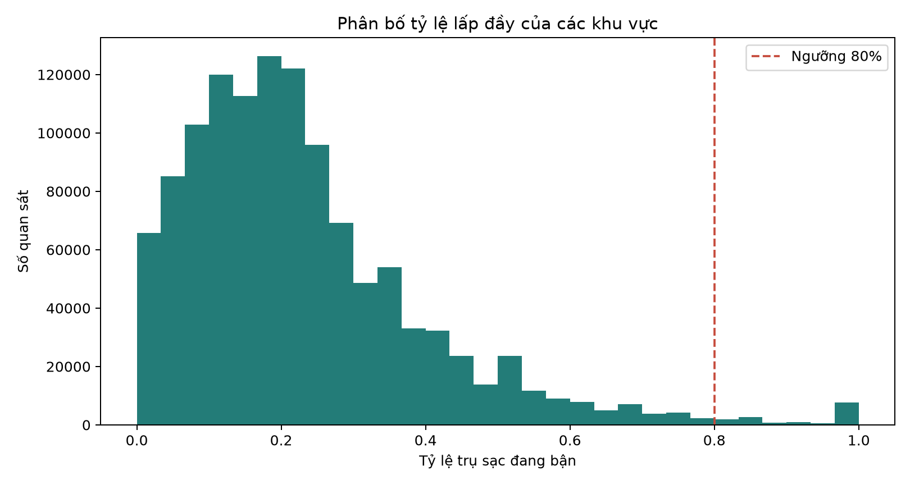

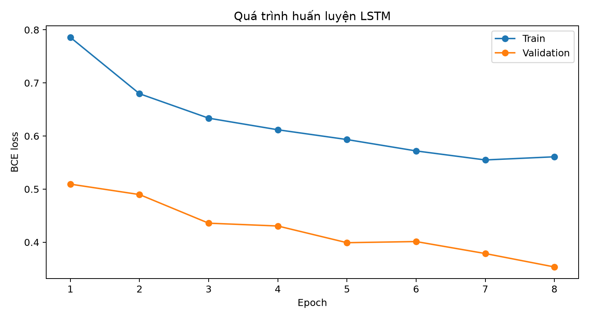

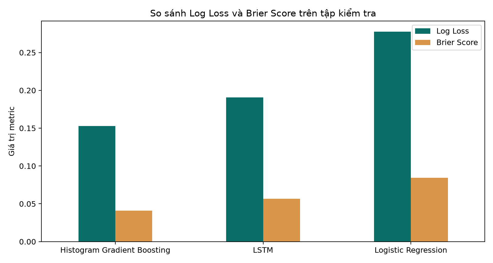

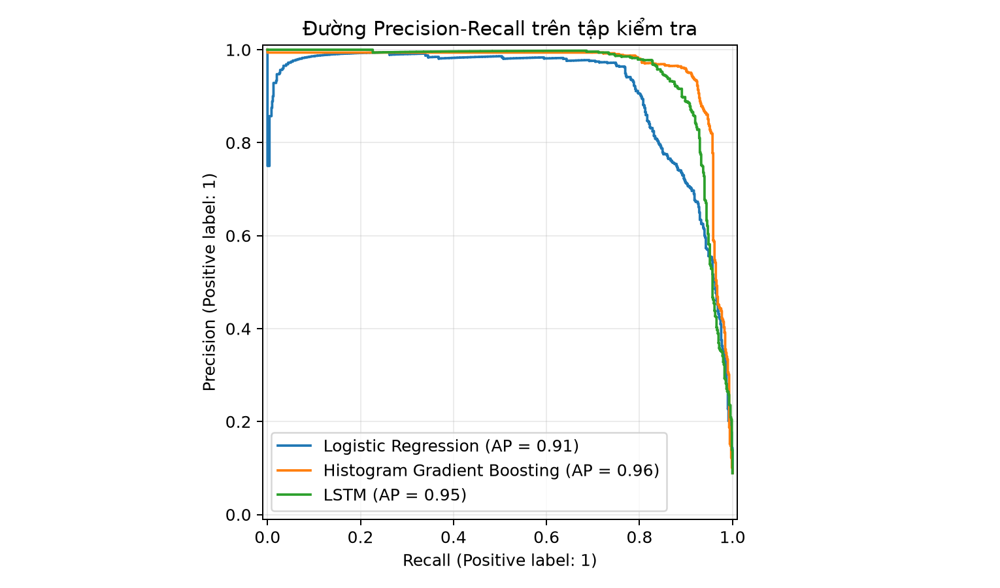

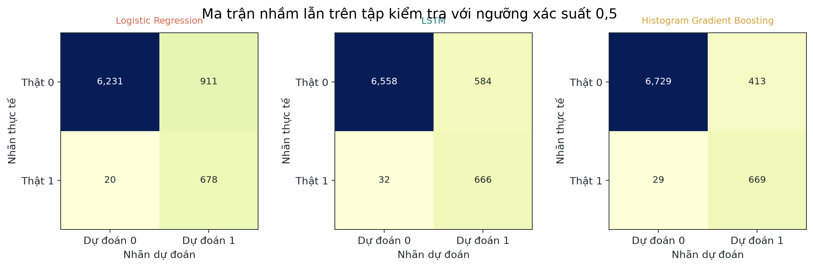

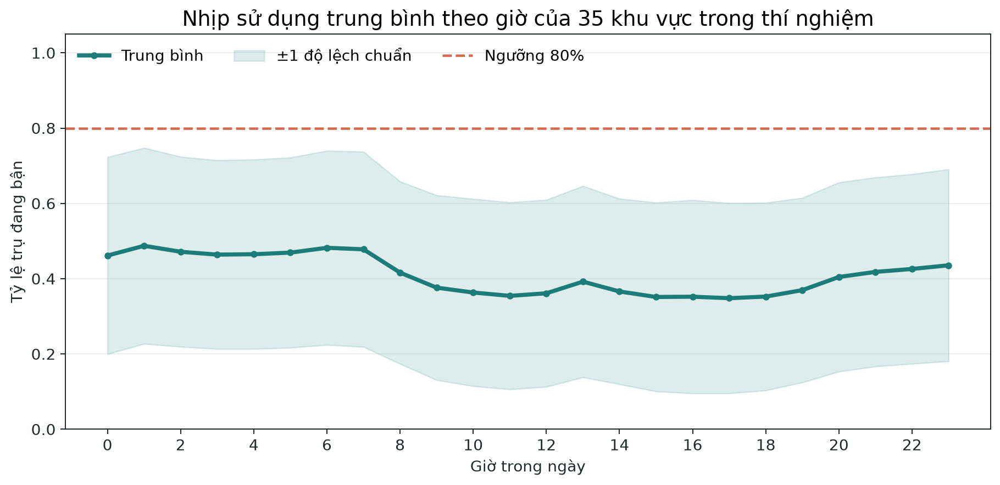

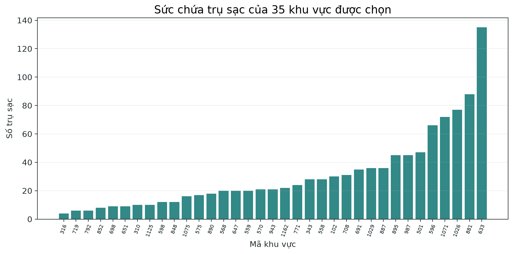

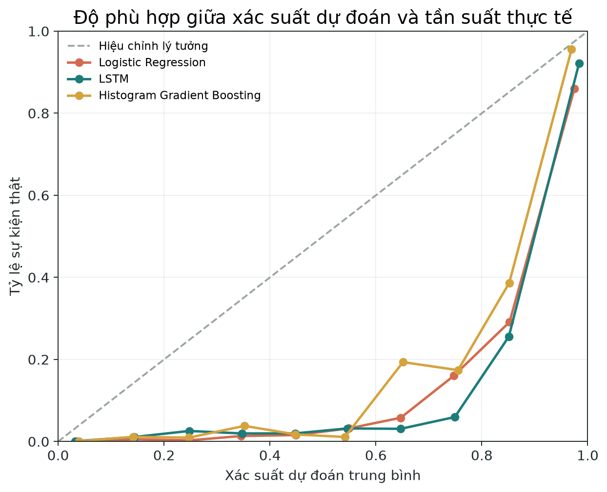

Các hình phân tích sâu được sinh từ cùng tập dự đoán của notebook:

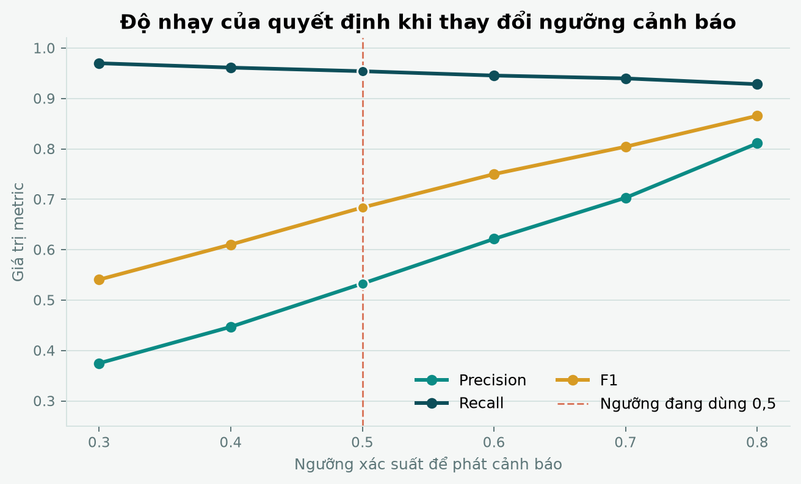

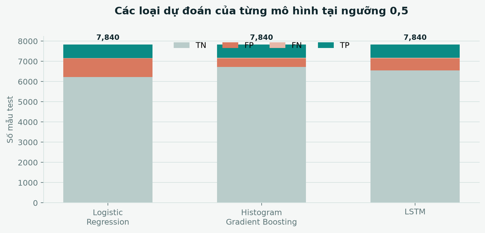


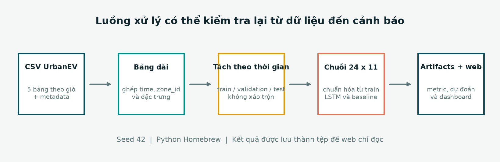

Ảnh giao diện demo được tạo khi chạy web cục bộ:


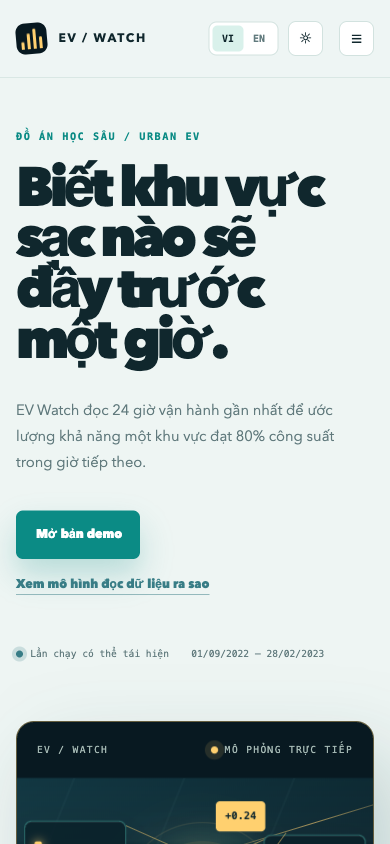

Giao diện hiện dùng nền xanh ngọc nhạt ở chế độ sáng và nền xanh đêm ở chế độ tối. Cảnh mô phỏng có lưới phối cảnh, quỹ đạo, điểm dữ liệu và hiệu ứng quét để diễn tả cách một khu vực được quan sát theo thời gian. Những hiệu ứng này chỉ phục vụ việc đọc giao diện, không phải dữ liệu mới và không thay đổi kết quả mô hình.

### Bài toán

Tại thời điểm cuối giờ `t`, mô hình nhận 24 giờ quan sát gần nhất của một khu vực:

- số trụ đang bận và sức chứa khu vực
- tỷ lệ lấp đầy
- sản lượng điện và thời lượng sạc
- giá điện và phí dịch vụ
- giờ trong ngày và ngày trong tuần

Đầu ra là xác suất khu vực đạt tỷ lệ lấp đầy từ 80% trở lên trong giờ `t + 1`.

```text
24 giờ lịch sử -> LSTM -> xác suất cảnh báo cho giờ kế tiếp
```

### Dữ liệu

Notebook dùng phần dữ liệu khu vực theo giờ đã được đặt trong repository tại `data/UrbanEV`. Bản này gồm 275 khu vực và giai đoạn từ 01/09/2022 đến 28/02/2023. Dữ liệu được đưa vào Git là bản khu vực theo giờ và metadata cần thiết để chạy notebook. Bản đầy đủ của Dryad còn có dữ liệu khu vực 5 phút và dữ liệu thô theo từng trạm, có kích thước khoảng 6 GB.

Phần dữ liệu hiện có trong repository gồm:

| File | Vai trò |
| --- | --- |
| `charge_1hour/occupancy.csv` | Số trụ đang bận theo từng khu vực và từng giờ |
| `charge_1hour/duration.csv` | Tổng thời lượng sạc trong một giờ, đơn vị giờ |
| `charge_1hour/volume.csv` | Tổng điện năng cấp trong một giờ, đơn vị kWh |
| `charge_1hour/e_price.csv` | Giá điện theo khu vực và thời gian |
| `charge_1hour/s_price.csv` | Phí dịch vụ theo khu vực và thời gian |
| `charge_1hour/volume-11kw.csv` | Biến thể volume theo công suất chuẩn 11 kW, không dùng trong mô hình chính |
| `zone-information.csv` | Sức chứa, tọa độ và thông tin hình học của 275 khu vực |
| `adj.csv`, `distance.csv` | Quan hệ kề và khoảng cách giữa các khu vực, chưa dùng trong mô hình chính |

Nguồn chính thức:

- Dryad dataset: https://doi.org/10.5061/dryad.np5hqc04z
- Repository dữ liệu: https://github.com/IntelligentSystemsLab/UrbanEV
- Bài mô tả dataset: https://doi.org/10.1038/s41597-025-04874-4
- Giấy phép dữ liệu: https://creativecommons.org/publicdomain/zero/1.0/

### Ghi nhận và cảm ơn

Project sử dụng dataset UrbanEV từ nguồn công khai. Mình chân thành cảm ơn Han Li, Haohao Qu, Xiaojun Tan, Linlin You, Rui Zhu và Wenqi Fan đã thu thập, xử lý và công khai dữ liệu để cộng đồng có thể học tập và nghiên cứu. Tên đề tài, code thử nghiệm và giao diện demo trong repository này là phần thực hành độc lập, không phải code chính thức của nhóm tác giả dataset.

Khi sử dụng dữ liệu cho mục đích học thuật, cần đọc giấy phép, trang Dryad và trích dẫn nguồn theo yêu cầu của nguồn gốc.

### Cấu trúc project

```text
.
├── data/UrbanEV/                 # Dữ liệu khu vực theo giờ được dùng trong notebook
├── notebooks/
│   └── 01_ev_area_early_warning.ipynb
├── src/ev_warning/               # Hàm đọc dữ liệu, tạo chuỗi, metric và LSTM
├── artifacts/                    # Metric, dự đoán và hình sinh từ lần chạy thử
├── web/                          # Demo tĩnh chạy được trên GitHub Pages
├── requirements.txt
└── README.md
```

### Sơ đồ xử lý

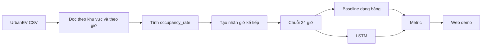

### Chạy notebook bằng Python Homebrew

Không cần tạo virtual environment trong project này. Kiểm tra Python:

```bash
/opt/homebrew/opt/python@3.13/libexec/bin/python3 --version
```

Di chuyển tới project:

```bash
cd "/Users/thanguit/Dev/ThacSiUIT/MonHoc/2026-2027/02_IS6109_HocSau_UngDungKinhDoanh/05_DoAn/02_CuoiKy/02_MaNguon/ev-charging-area-early-warning"
```

Mở notebook:

```bash
/opt/homebrew/opt/python@3.13/libexec/bin/python3 -m notebook notebooks/01_ev_area_early_warning.ipynb
```

Notebook sẽ sinh:

- `artifacts/metrics.csv`
- `artifacts/test_predictions.csv`
- `artifacts/run_summary.json`
- các biểu đồ trong `artifacts/figures/`

### Chạy web demo

Không mở `index.html` bằng cách double-click vì trình duyệt có thể chặn việc đọc file JSON. Chạy server tĩnh:

```bash
/opt/homebrew/opt/python@3.13/libexec/bin/python3 -m http.server 8000 --directory web
```

Mở: http://localhost:8000

Web demo có:

- giao diện tiếng Việt và tiếng Anh
- theme sáng và tối
- chọn khu vực và mốc quan sát
- xác suất cảnh báo của LSTM
- tỷ lệ hiện tại và tỷ lệ giờ kế tiếp
- biểu đồ diễn biến xác suất
- bảng so sánh các mô hình
- liên kết tới nguồn dataset chính thức
- cảnh mô phỏng khu vực sạc dạng phối cảnh với chuyển động nhẹ
- cảnh 3D mô phỏng khu vực, quỹ đạo, điểm dữ liệu và hiệu ứng quét tín hiệu
- dải hướng dẫn đọc cảnh báo theo ba bước: xác suất, trạng thái hiện tại và quyết định của người vận hành
- chuyển ngôn ngữ bằng nút VI/EN và theme sáng/tối
- bố cục responsive cho desktop, tablet và mobile

### Triển khai GitHub Pages

Repository có workflow `.github/workflows/deploy-pages.yml` để triển khai riêng thư mục `web`. Sau khi push code, vào **Settings → Pages**, chọn **GitHub Actions** làm source. Mỗi lần push lên `main`, workflow sẽ đóng gói thư mục `web` và cập nhật trang demo.

### Ghi chú về kết quả

Trong lần chạy mẫu được lưu trong `artifacts`, Histogram Gradient Boosting có kết quả tốt hơn LSTM. Đây là kết quả thực nghiệm cần giữ nguyên, không thay bằng một con số đẹp hơn. Mục tiêu của project là đánh giá công bằng mô hình học sâu so với baseline, không mặc định LSTM luôn tốt nhất.

## English

### Purpose

This individual project was created for the IS6109 Deep Learning and Business Applications course. It explores early prediction of whether an electric vehicle charging area may reach high occupancy in the next hour.

The main model is an LSTM network. Logistic Regression and Histogram Gradient Boosting are used as baselines to compare sequence learning with tabular learning.

This repository is an individual learning project for the IS6109 Deep Learning and Business Applications course. It is not intended for commercial use and is not affiliated with the creators of UrbanEV.

### Demo and repository contents

The project predicts the probability that an EV charging area will reach at least 80% occupancy in the next hour. The LSTM receives a 24-hour window with 11 features. Logistic Regression and Histogram Gradient Boosting are included as baselines.

The repository contains the hourly area-level files required by the notebook, reusable Python modules, generated evaluation artifacts, and a bilingual static web demo. The full public release also contains five-minute and station-level data, which are not copied into this repository.


### Task definition

At the end of hour `t`, the model receives the previous 24 hours of area-level observations and returns the probability that the area will reach at least 80% occupancy during hour `t + 1`.

### Dataset and acknowledgment

The project uses the publicly available UrbanEV dataset. We sincerely thank Han Li, Haohao Qu, Xiaojun Tan, Linlin You, Rui Zhu, and Wenqi Fan for collecting, processing, and sharing the data for research and learning. The independent code, analysis design, and web demo in this repository are not the official implementation of the dataset creators.

Official sources:

- Dryad dataset: https://doi.org/10.5061/dryad.np5hqc04z
- Official repository: https://github.com/IntelligentSystemsLab/UrbanEV
- Dataset paper: https://doi.org/10.1038/s41597-025-04874-4
- Dataset license: https://creativecommons.org/publicdomain/zero/1.0/

### License and use

The dataset is marked CC0 1.0 in the Dryad metadata. Please keep the original attribution and review the source terms before redistribution or publication. This repository is an educational project and is not intended for commercial use.

### Run

Use the Python Homebrew interpreter and follow the Vietnamese setup commands above. The `web` folder is a static site and can be deployed to GitHub Pages with the included workflow.

## Tài liệu tham khảo chính

```text
[1] H. Li, H. Qu, X. Tan, L. You, R. Zhu, and W. Fan, “UrbanEV: An Open Benchmark Dataset for Urban Electric Vehicle Charging Demand Prediction,” Scientific Data, vol. 12, Art. no. 523, 2025, doi: 10.1038/s41597-025-04874-4.

[2] UrbanEV, “UrbanEV dataset,” Dryad, published Mar. 17, 2025, updated Feb. 4, 2026. doi: 10.5061/dryad.np5hqc04z.

[3] S. Hochreiter and J. Schmidhuber, “Long short-term memory,” Neural Computation, vol. 9, no. 8, pp. 1735–1780, 1997, doi: 10.1162/neco.1997.9.8.1735.

[4] A. Paszke et al., “PyTorch: An imperative style, high-performance deep learning library,” in Advances in Neural Information Processing Systems, vol. 32, 2019.
```
